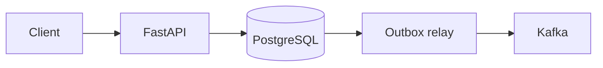

# Shipments API architecture

Shipments API creates shipments, exposes their current status and history, and publishes status changes to Kafka. The FastAPI application and the outbox relay run as separate processes and share the service's PostgreSQL database.

## Application layers

| Layer | Responsibility |
| --- | --- |
| `api` | Accepts HTTP requests, validates input through Pydantic schemas, and maps domain exceptions to HTTP responses. |
| `service` | Runs shipment use cases and owns transaction boundaries. |
| `domain` | Defines shipment statuses, allowed transitions, tracking number generation, and domain exceptions. |
| `repository` and `models` | Run database queries and map rows to SQLAlchemy objects. |
| `relay` | Polls the outbox and publishes events through the `EventPublisher` interface. `KafkaPublisher` adapts the Kafka producer to that interface. |

The request path is `api → service → repository → models`. FastAPI's `Depends` wires the service and repositories to the same request-scoped async SQLAlchemy session. The domain can be tested independently of FastAPI and PostgreSQL.

## HTTP interface

| Method and path | Behavior |
| --- | --- |
| `POST /shipments` | Creates a shipment in `created` status and records the first history entry. Returns HTTP 201. |
| `GET /shipments` | Lists shipments with an optional status filter and `limit`/`offset` pagination. |
| `GET /shipments/{shipment_id}` | Reads the shipment by its UUID. |
| `GET /shipments/{shipment_id}/history` | Lists status history in ascending history ID order. |
| `PATCH /shipments/{shipment_id}/status` | Applies an allowed transition and accepts an optional comment. |

A missing shipment returns HTTP 404. A disallowed transition returns HTTP 409. The allowed transitions are defined in [domain/statuses.py](../src/shipments_api/domain/statuses.py).

## Data and consistency

| Table | Role |
| --- | --- |
| `shipments` | Stores a shipment by UUID, its unique tracking number, and its current status for reads and filtering. |
| `status_history` | Records each status with a foreign key to the shipment. The `(shipment_id, id)` index supports ordered history reads. |
| `outbox_events` | Stores the complete event payload as JSONB, a unique event UUID, and a nullable `published_at` timestamp. A partial index supports polling unpublished rows by their numeric ID. |

Creation writes the shipment and its initial history entry in one transaction. A later status change locks the shipment row with `SELECT … FOR UPDATE` before checking the transition. Concurrent updates to the same shipment wait for the lock and validate against the status they read after acquiring it.

The status update, new history entry, and outbox insert commit together. If any write fails, PostgreSQL rolls back all three. The service keeps the stored current status consistent with history.

## Event delivery

The **Transactional Outbox** pattern stores a pending message in PostgreSQL within the same transaction as the business change. For a status change, the stored event is `shipment.status_changed` with `event_version` set to `1`. It contains `event_id`, `occurred_at`, `shipment_id`, `tracking_number`, the old and new statuses, and the optional comment. Shipment creation writes history only.

1. One relay process reads unpublished rows by ascending outbox ID and closes the read transaction.
2. The relay publishes each payload to the configured Kafka topic using `shipment_id` as the message key. Kafka orders messages within a partition, and the key routes events for the same shipment to the same partition.
3. After Kafka acknowledges the message, the relay records `published_at` in a separate transaction. After a publishing error, the relay waits for the polling interval before trying again.

Delivery is **at least once**. If the relay stops after Kafka acknowledges the message and before the database commits `published_at`, the same event can be sent again. A consumer can use the stable `event_id` to process duplicate deliveries only once.

See the [decision log](DECISIONS.md) for design trade-offs and the [README](../README.md) for local setup.
